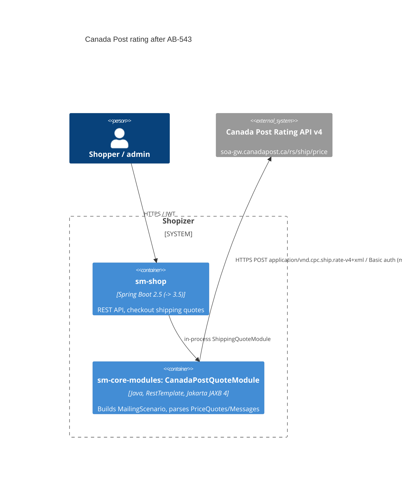

# 0001. Own the Canada Post rating integration in sm-core-modules on Jakarta XML Binding 4

- **Status:** Proposed
- **Date:** 2026-11-11
- **ARB ticket:** TO BE CREATED
- **Authors:** Devin (AB-543)
- **Owning team:** TBD — Shopizer core/shipping owners to confirm before ARB
- **Related ADRs:** none (first ADR); epic AB-531 (Spring Boot 3.5 / Java 21 / Jakarta EE 10)

## Context

`sm-core` depended on the external `com.shopizer:shipping-canadapost-spring-boot-starter:2.17.0`.
Its autoconfigure jar uses `javax.xml.bind` (JAXB-generated Canada Post rating types) and Jersey 1
(`com.sun.jersey`, `javax.ws.rs`). No Jakarta release exists, so it blocks the Spring Boot 3 cut-over
(AB-544). The integration is small: one `ShippingQuoteModule` bean (`canadapost`), one config bean and
the rating request/response types.

ARB triggers: **T7** — introduces the Jakarta XML Binding 4 framework (`jakarta.xml.bind-api` 4.0.2,
`org.glassfish.jaxb:jaxb-runtime` 4.0.5, `jakarta.activation-api` 2.1.3) replacing JAXB 2.3 / Jersey 1,
as part of the Boot 2 → 3 programme. Also noted (not ARB-required on their own): an externally
published shared component is replaced by in-repo code (ownership moves to this repo); the external
vendor (Canada Post Rating API v4) is unchanged — not a new T3 vendor.

## Decision

We will vendor the Canada Post rating module into `sm-core-modules` (same package names, `canadapost`
bean name, endpoints and behaviour), hand-port only the consumed rating/messages types with
`jakarta.xml.bind` annotations, replace Jersey 1 with Spring `RestTemplate`, and remove the starter.
Because Hibernate 5.4 constructs its JAXB XML binder during bootstrap even without XML mappings, we
keep `javax.xml.bind:jaxb-api:2.3.1` (API only, no javax implementation) in `sm-core` as a temporary
bridge until the Hibernate 6 / Boot 3 cut-over (AB-544) removes it.

## Alternatives considered

| Alternative | Pros | Cons | Why rejected |
| --- | --- | --- | --- |
| Do nothing | No change | Starter cannot run on Spring 6 / Jakarta | Blocks AB-544 |
| (b) Keep starter + javax JAXB / Jersey 1 shim | Smallest diff | Jersey 1 and javax JAXB are dead on Boot 3; still blocks cut-over | Only defers the problem |
| Regenerate all types from Canada Post XSDs via jaxb-maven-plugin | Full API surface | XSDs not shipped in the jar; adds build plugin; 60+ unused types | Hand-port of the consumed types is smaller and fully covered by golden tests |
| Jackson XML instead of JAXB | Namespace-neutral | New dependency, different binding semantics vs original | JAXB 4 keeps element/namespace mapping identical to the original |

## Architecture

## Non-functional requirements

| NFR | Target | How met |
| --- | --- | --- |
| Availability SLO | Unchanged from today | Same synchronous call path, no new infra |
| p95 latency | Unchanged (no timeout configured before or after) | Same blocking HTTP behaviour; timeout hardening is a follow-up |
| RPO / RTO | N/A — no data store | |
| Peak load | Unchanged | |
| Scaling model | Unchanged (in-process) | |
| Data retention | N/A | |

## Security & compliance

- **Data classification:** shipping addresses/postcodes and parcel dimensions (unchanged flow).
- **Encryption at rest:** N/A. **In transit:** HTTPS to Canada Post (unchanged).
- **AuthN / AuthZ:** Basic auth with merchant-configured Canada Post username/password (unchanged storage in integration configuration).
- **Secrets:** unchanged; no new secrets.
- **Audit logging:** unchanged.
- **Data residency / regions:** unchanged.
- **Threats considered:** XML parsing of vendor responses now via JAXB 4 (no DTD/external entities in the hand-ported unmarshal path); removal of unmaintained Jersey 1.19 reduces CVE surface.

## Cost

| Item | Assumption | Monthly estimate |
| --- | --- | --- |
| None | No new infra or vendors | $0 |
| **Total** | | $0 |

## Operations

- **On-call rotation:** TBD — owner to confirm.
- **Runbook:** `docs/upgrade/canada-post-port.md`.
- **Dashboards / alarms:** unchanged.
- **Rollback plan:** revert the AB-543 PR (restores the starter dependency).
- **Migration / cut-over plan:** lands on Boot 2.5; AB-544 removes the `javax.xml.bind:jaxb-api` bridge and may move `RestTemplate` to `RestClient`.

## Policy exceptions requested

| Rule | Resource | Justification | Compensating control | Expiry |
| --- | --- | --- | --- | --- |
| none | | | | |

## Consequences

- Positive: unblocks AB-544; removes Jersey 1 / JAX-RS and the javax JAXB implementation; golden parity tests pin behaviour.
- Negative / risks: Canada Post code is now owned in-repo; temporary javax JAXB API bridge for Hibernate 5.4; Hibernate `hbm.xml`/`orm.xml` mappings are not supported until AB-544 (none exist today).
- Follow-ups: AB-544 drop `javax.xml.bind:jaxb-api`; consider connect/read timeouts (behaviour change, separate ticket).

## Open questions

- Owning team and on-call for the in-repo Canada Post module.
