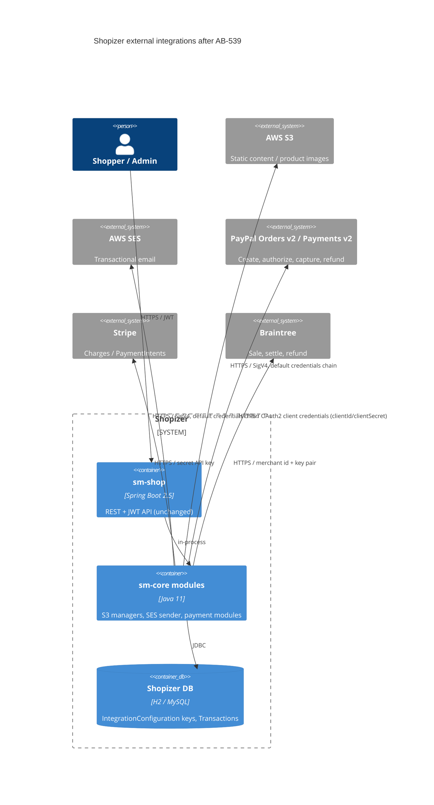

# 0001. Integration SDKs: AWS SDK v2, PayPal Orders v2, current Stripe and Braintree

- **Status:** Proposed
- **Date:** 2026-11-11
- **ARB ticket:** TO BE CREATED
- **Authors:** Devin (AB-539)
- **Owning team:** TBD — owner to confirm before ARB (Shopizer platform team)
- **Related ADRs:** none (first ADR in this repository). Part of epic AB-531 (Spring Boot 3.5 / Java 21).

## Context

Shopizer's `sm-core` integrates with four external providers through vendor SDKs that are end of
life or block the Jakarta / Spring Boot 3 cut-over (AB-544):

- AWS SDK for Java v1 1.11.640 (`com.amazonaws`) for S3 content storage and SES email — v1 is end of support.
- PayPal `merchantsdk` 2.6.109 (NVP/SOAP, `urn.ebay.*`) for Express Checkout — deprecated by PayPal,
  authenticates with API username/password/signature.
- `stripe-java` 19.5.0 and `braintree-java` 2.73.0 — several majors behind.

The change must keep the `PaymentModule`, `ContentAssetsManager` / product file manager and email sender
contracts, S3 object keys and SES content unchanged, and stay on Spring Boot 2.5 / javax until AB-544.

ARB triggers:

- **T6** (auth boundary): PayPal authentication moves from NVP API signature credentials to OAuth 2.0
  client credentials (`clientId` / `clientSecret`); AWS credential resolution moves to the v2
  `DefaultCredentialsProvider` chain (system properties now take precedence over environment variables).
- **T3** (external dependency): new artifact `com.paypal.sdk:paypal-server-sdk` (APIMatic-generated,
  brings OkHttp 4 / Okio 3 / Kotlin stdlib); same vendor, approved category.
- **T7** (major upgrade): AWS SDK v1 → v2, Stripe 19 → 34, Braintree 2 → 3; shared transitive
  alignment of Gson 2.10.1, OkHttp 4.12.0, Okio 3.6.0, Kotlin 1.9.10.

## Decision

We will replace AWS SDK v1 with AWS SDK v2 (`software.amazon.awssdk:bom` 2.51.0, `S3Client`, `SesClient`,
default credentials chain), replace the PayPal Merchant SDK with the PayPal Server SDK 2.4.0 (Orders v2 /
Payments v2) behind a package-private `PayPalGateway`, and bump `stripe-java` to 34.1.0 and
`braintree-java` to 3.55.1 behind injectable seams (`StripeGateway`, injectable `BraintreeGateway`),
preserving the existing module contracts, transaction types and transaction-detail keys.

## Alternatives considered

| Alternative | Pros | Cons | Why rejected |
| --- | --- | --- | --- |
| Do nothing | No risk now | v1 AWS SDK and NVP SDK are EOL/deprecated and keep javax/legacy deps into Boot 3 | Blocks AB-544 and leaves unsupported SDKs in payment and storage paths |
| Call PayPal Orders v2 REST directly with an in-house HTTP client | No new vendor artifact or OkHttp/Kotlin transitive deps | In-house OAuth token handling, retries and models to maintain | PayPal's supported SDK is lower long-term risk; ticket scope specifies the Server SDK |
| Keep PayPal on the legacy REST SDK (`com.paypal.api` / rest-api-sdk) | Smaller code change | Also deprecated (v1 Payments API) | Does not remove deprecated PayPal APIs |
| Do the swaps inside the AB-544 cut-over | One PR | Makes the forced serialization point much larger and harder to review | Epic plan pulls judgment-heavy changes into Wave 1 |

## Architecture

No new deployable, data store, endpoint or schema. The only stored-data change is the content of the
PayPal `IntegrationConfiguration.integrationKeys` map (new keys `clientId`, `clientSecret`) and additive
transaction-detail keys (`APPROVALURL`, `CAPTUREID`).

## Non-functional requirements

| NFR | Target | How met |
| --- | --- | --- |
| Availability SLO | Unchanged | Same synchronous provider calls as before |
| p95 latency | Unchanged — TBD, owner to confirm baseline | PayPal adds one OAuth token call per new client (token cached by SDK) |
| RPO / RTO | N/A — no data store change | |
| Peak load | Unchanged | |
| Scaling model | Unchanged (stateless app) | SDK clients created per module call, as before |
| Data retention | Unchanged | |

## Security & compliance

- **Data classification:** payment credentials (secret) in IntegrationConfiguration; cardholder data stays with providers (tokens/nonces only), unchanged.
- **Encryption at rest:** unchanged (existing DB storage of integration keys).
- **Encryption in transit:** TLS to all providers (SDK defaults).
- **AuthN / AuthZ:** PayPal OAuth2 client credentials replace NVP signature; AWS default credentials chain (prefer IAM roles); Stripe/Braintree keys unchanged.
- **Secrets:** no credentials in the repo; merchants re-enter PayPal REST app credentials via the existing admin config API. Old NVP keys must be removed after migration.
- **Audit logging:** unchanged; PayPal debug ID stored in `CORRELATION`.
- **Data residency / regions:** unchanged (same S3/SES region keys).
- **Policy sections satisfied:** no infrastructure changes; no new vendors.
- **Threats considered:** credential-source precedence change in AWS v2 (system properties over env vars) could pick up an unintended credential — documented; dependency supply chain — only vendor-official artifacts from Maven Central.

## Cost

| Item | Assumption | Monthly estimate |
| --- | --- | --- |
| Provider fees | Same transaction volume and pricing | $0 change |
| **Total** | | $0 incremental |

## Operations

- **On-call rotation:** TBD — owner to confirm before ARB.
- **Runbook:** `docs/upgrade/ab-539-integration-sdks.md` (to be folded into AB-549 upgrade notes / rollback runbook).
- **Dashboards / alarms:** existing payment error logging; no new alarms.
- **Rollback plan:** revert the AB-539 merge; restore PayPal NVP keys in IntegrationConfiguration (keep a backup before migration).
- **Migration / cut-over plan:** per merchant, create a PayPal REST app, store `clientId`/`clientSecret`, run a sandbox authorize/capture/partial refund, settle legacy in-flight EC authorizations before switching, adopt `APPROVALURL` for payer redirect.

## Policy exceptions requested

| Rule | Resource | Justification | Compensating control | Expiry |
| --- | --- | --- | --- | --- |
| none | | | | |

## Consequences

- Positive: supported SDKs on all four providers; no javax-bound legacy SDKs before AB-544; payment and storage modules unit-tested with mocked clients.
- Negative / risks: PayPal merchants must re-provision credentials; in-flight NVP EC tokens cannot be resumed; the storefront must use `APPROVALURL` instead of the legacy `webscr` URL; aligned Gson/OkHttp/Okio/Kotlin versions are shared by other libraries.
- Follow-ups: AB-549 publishes the migration; AB-548 parity run; live sandbox verification per provider.

## Open questions

- Owning team and on-call rotation.
- Baseline payment latency to compare post-migration.
- Whether the admin UI (shopizer-admin) needs new PayPal credential fields (out of this repo's scope).
