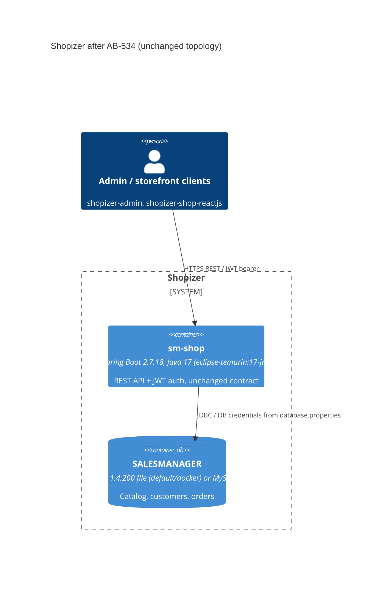

# 0002. Spring Boot 2.7.18 and a Java 17 bytecode/runtime baseline

- **Status:** Proposed
- **Date:** 2026-11-11
- **ARB ticket:** TO BE CREATED
- **Authors:** Devin (AB-534)
- **Owning team:** TBD — owner to confirm before ARB
- **Related ADRs:** none (first ADR in this repository). Epic AB-531 (Spring Boot 3.5 / Java 21) carries its own ARB triage on AB-544.

## Context

Shopizer runs on Spring Boot 2.5.12, compiled with `source`/`target` 11, and its Docker image uses
`adoptopenjdk/openjdk11-openj9:alpine`. AdoptOpenJDK images are no longer maintained. Epic AB-531
moves the application to Spring Boot 3.5 / Java 21 in waves. AB-534 is the Wave 1 step that
AB-535 (`SecurityFilterChain`, needs Spring Security 5.7) and AB-544 (the Boot 3 cut-over) depend on.

Boot 2.6/2.7 changes that affect Shopizer:

- MVC path matching defaults to `PathPatternParser`, which springfox 2.9.2 cannot read.
  Actuator endpoint mappings use `PathPatternParser` even when the MVC strategy is overridden.
- Circular bean references are prohibited by default.
- Boot 2.7 manages H2 2.1.x, which cannot open the committed PageStore `SALESMANAGER.h2.db` or the
  `mv_store=false` URLs in the `docker`/`cloud` profiles.

ARB triggers: T7 (framework minor upgrade Spring Boot 2.5 → 2.7, and a major runtime baseline raise
Java 11 → 17 for the deployable jar and its container image). Not triggered: T1, T2, T3, T4, T5, T6, T8, T9.

## Decision

We will build on `spring-boot-starter-parent` 2.7.18 with `maven.compiler.release` 17. We keep
current behaviour with `spring.mvc.pathmatch.matching-strategy=ant_path_matcher` and
`spring.main.allow-circular-references=true`. The existing bean cycles are listed in the AB-534
PR for later cleanup. springfox skips the PathPatternParser-based actuator handler mappings, which
it never documented. `h2.version` stays pinned to 1.4.200 until AB-544. The container base image
moves to `eclipse-temurin:17-jre`, because Java 17 bytecode cannot run on the Java 11 image.

## Alternatives considered

| Alternative | Pros | Cons | Why rejected |
| --- | --- | --- | --- |
| Do nothing (stay on Boot 2.5.12 / Java 11) | No change risk | Boot 2.5 is out of OSS support. AB-535 needs Spring Security 5.7. Leaves all of the Boot 3 work for AB-544 | Blocks the epic critical path |
| Boot 2.7 but keep `release` 11 | Image could stay on Java 11 | CI already builds and tests on 17 and 21 only. Delays the bytecode baseline to the AB-544 cut-over and makes that PR bigger | Ticket scope requires `release` 17 |
| Boot 2.7 with the H2 2.x migration now | One fewer pin | Bundled demo DB and profile URLs stop working. Overlaps AB-544 | Out of scope (AB-544) |
| Fix bean cycles now instead of allowing them | Cleaner wiring | Touches services owned by AB-541 and others. Risks functional change | Ticket says list cycles for later cleanup |

## Architecture

The deployable topology is unchanged. Only framework and runtime versions change.

## Non-functional requirements

| NFR | Target | How met |
| --- | --- | --- |
| Availability SLO | TBD — owner to confirm before ARB | No topology change |
| p95 latency | TBD — owner to confirm before ARB | No functional change. Not benchmarked in AB-534 |
| RPO / RTO | Unchanged | Data stores and schema unchanged |
| Peak load | TBD — owner to confirm before ARB | Unchanged |
| Scaling model | Unchanged | Single stateless app plus database |
| Data retention | Unchanged | No schema or data changes |

## Security & compliance

- **Data classification:** Unchanged (customer PII and order data, as before).
- **Encryption at rest:** Unchanged. Not affected by this change.
- **Encryption in transit:** Unchanged.
- **AuthN / AuthZ:** Unchanged. `MultipleEntryPointsSecurityConfig` still uses the deprecated
  `WebSecurityConfigurerAdapter` (it still works on Security 5.7). AB-535 rewrites it.
  The JWT login and 401/200 behaviour on `/api/v1/private/**` were smoke-tested.
- **Secrets:** Unchanged.
- **Audit logging:** Unchanged.
- **Data residency / regions:** Unchanged.
- **Policy sections satisfied:** No infrastructure resources are added. There is no `policy/approved-infra.yaml` in this repository.
- **Threats considered:** Boot 2.7.18 / Spring 5.3.31 pick up upstream security fixes over 2.5.12.
  H2 stays on 1.4.200, which has known CVEs. It is only used for local/demo profiles, and AB-544 removes the pin.

## Cost

| Item | Assumption | Monthly estimate |
| --- | --- | --- |
| Runtime image change | Same container footprint | $0 incremental |
| **Total** | | $0 incremental |

## Operations

- **On-call rotation:** TBD — owner to confirm before ARB.
- **Runbook:** Upgrade notes and rollback runbook are delivered by AB-549.
- **Dashboards / alarms:** Unchanged. Actuator endpoints are still exposed.
- **Rollback plan:** Revert the AB-534 merge commit on `epic/ab-531-v2`. That restores Boot 2.5.12,
  `source`/`target` 11 and the Java 11 image. Data and schema are unaffected.
- **Migration / cut-over plan:** Lands on the epic integration branch only. Reaches `3.2.7` with the epic PR, after ARB.

## Policy exceptions requested

| Rule | Resource | Justification | Compensating control | Expiry |
| --- | --- | --- | --- | --- |
| none | | | | |

## Consequences

- Positive: Unblocks AB-535 and AB-544. Moves to a supported Boot 2.x line and a maintained JRE image.
- Negative / risks: Allowed circular references and the springfox actuator workaround are
  temporary debt. The JVM implementation in the image changes from OpenJ9 to HotSpot (Temurin),
  so memory and GC profiles may differ in production.
- Follow-ups: Break the listed bean cycles. AB-536 removes springfox and this workaround.
  AB-544 removes the H2 pin. AB-547 moves the image to `eclipse-temurin:21-jre`.

## Open questions

- Owning team and on-call rotation.
- Whether production deployments use this Dockerfile, or another image that also needs a Java 17+ runtime.
- Do production memory settings need retuning for the move from OpenJ9 to HotSpot?
