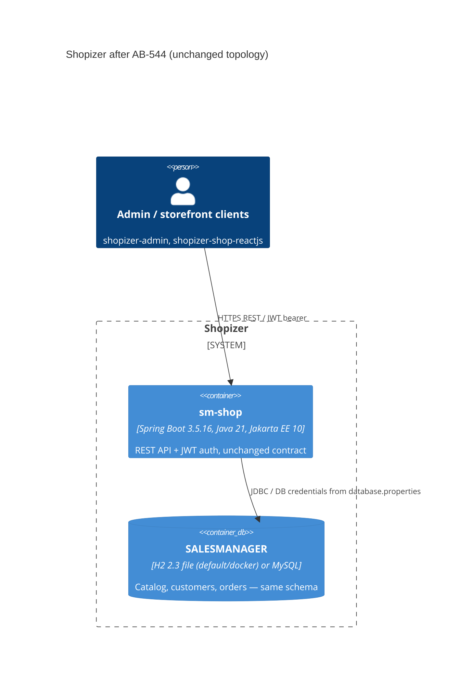

# 0003. Spring Boot 3.5 / Java 21 / Jakarta EE 10 atomic cut-over

- **Status:** Proposed
- **Date:** 2026-11-11
- **ARB ticket:** TO BE CREATED
- **Authors:** Devin (AB-544)
- **Owning team:** TBD — owner to confirm before ARB
- **Related ADRs:** 0001 (integration SDKs), 0002 (Boot 2.7 / Java 17 baseline, the direct predecessor).
  Epic AB-531.

## Context

After Wave 1 (AB-533..AB-543) Shopizer builds on Spring Boot 2.7.18 / Java 17 / `javax.*`. Boot 2.7 is
out of OSS support, and every remaining epic ticket (Drools 10, Infinispan 15, Java 21 image) needs
the Jakarta EE 10 namespace. The REST + JWT contract consumed by shopizer-admin and
shopizer-shop-reactjs must not change.

ARB triggers: **T7 — major framework replacement** (Spring Boot 2.7 → 3.5, Spring Framework 6.2,
Spring Security 6.5, Hibernate ORM 6.6, Jakarta EE 10 namespaces, springdoc 2.x) and **T3 — new
external dependencies replacing vendors of the same role** (Eclipse Angus Mail replaces
`javax.mail:mail`; `com.mysql:mysql-connector-j` replaces `mysql:mysql-connector-java`; H2 2.3 with a
regenerated bundled database). Not triggered: T1 (no new service/component), T2 (no new data store:
same schema, same tables, same `SM_SEQUENCER` rows), T4 (no new cross-domain integration), T5/T6 (no
infrastructure or network change), T8 (auth boundary unchanged: the AB-535 matcher table is ported
1:1 to the Security 6 DSL), T9 (no data classification change).

## Decision

One atomic PR moves all five modules (`sm-core-model`, `sm-core-modules`, `sm-core`, `sm-shop-model`,
`sm-shop`) to `spring-boot-starter-parent` 3.5.16 with `maven.compiler.release` 21:

- `javax.{persistence,inject,validation,servlet,annotation,mail,activation,xml.bind}` →
  `jakarta.*` via OpenRewrite `org.openrewrite.java.migrate.jakarta.JavaxMigrationToJakarta`
  (353 files); POM coordinates follow (`jakarta.inject-api`, `jakarta.validation-api`,
  `jakarta.mail-api` + `angus-mail`, `jakarta.annotation-api`, `org.hibernate.orm:hibernate-jcache`,
  Ehcache 3 `jakarta` classifier, `springdoc-openapi-starter-webmvc-ui` 2.8.17,
  `swagger-annotations-jakarta`, `mysql-connector-j`, H2 managed by Boot).
- Hibernate 6: `@Type(TextType)` → `@JdbcTypeCode(SqlTypes.LONGVARCHAR)`, `@Type("locale")` dropped,
  `VALUE` columns quoted for H2 2.x, and the Hibernate 5 legacy hi/lo `SM_SEQUENCER` arithmetic is
  reproduced by `LegacyHiLoTableGenerator` (see `docs/upgrade/id-generation.md`), so existing
  databases keep issuing the same identifiers.
- Spring Security 6: `securityMatcher`/`requestMatchers`/`authorizeHttpRequests` lambda DSL with the
  exact AB-535 path table, `@EnableMethodSecurity` instead of `@EnableGlobalMethodSecurity`.
- Spring MVC 6: `ant_path_matcher` kept and trailing-slash matching re-enabled, because the
  frontends call `/api/v1/cart/`, `/api/v1/category/` etc.
- H2 2.x: `mv_store=false` removed from every profile URL, the bundled `SALESMANAGER.h2.db`
  (PageStore) replaced by `SALESMANAGER.mv.db` exported from 1.4.200 and re-imported with 2.3.232.
- Caffeine pinned to 2.9.3 only because Infinispan 9.4 still needs it; AB-545 removes the pin.

## Alternatives considered

| Alternative | Pros | Cons | Why rejected |
| --- | --- | --- | --- |
| Module-by-module migration | Smaller PRs | `javax`/`jakarta` cannot coexist in one Spring context; intermediate states do not build or boot | Epic mandates an atomic cut-over |
| Boot 3.3/3.4 instead of 3.5 | Slightly older, more field time | 3.3 is out of OSS support, 3.4 ends in 2025; the epic targets 3.5 | Ticket scope |
| Change the 62 `@TableGenerator` annotations to `allocationSize=49`/`initialValue=0` | No custom generator class | Semantically misleading JPA metadata; silently reverts to pooled blocks of 49 if the optimizer setting is ever removed | Parity must not depend on annotations drifting |
| Accept Hibernate 6 pooled identifiers (new ID arithmetic) | Zero code | Existing deployments would skip/clash identifiers per AB-541 analysis | Behaviour change |
| `hibernate.globally_quoted_identifiers` for the H2 reserved word `VALUE` | One property | Quotes every identifier on MySQL too, changing case-sensitivity semantics | Over-broad; six explicit column quotes instead |

## Architecture

Topology is unchanged; only framework and runtime versions change.

## Non-functional requirements

| NFR | Target | How met |
| --- | --- | --- |
| Availability SLO | TBD — owner to confirm before ARB | No topology change |
| p95 latency | TBD — owner to confirm before ARB | No functional change; not benchmarked in AB-544 |
| RPO / RTO | Unchanged | Schema unchanged; H2 demo DB regenerated from the committed seed |
| Peak load | TBD — owner to confirm before ARB | Unchanged |
| Scaling model | Unchanged | Single stateless app plus database |
| Data retention | Unchanged | No schema or data changes |

## Security & compliance

- **Data classification:** Unchanged.
- **Encryption at rest / in transit:** Unchanged.
- **AuthN / AuthZ:** Same filter chains, entry points, realms and role checks as AB-535; verified by
  `SecurityFilterChainIntegrationTest`, `BehaviourSmokeTest` and `ApiContractTest`.
- **Secrets:** Unchanged.
- **Audit logging:** Unchanged.
- **Policy sections satisfied:** No infrastructure resources are added. No `policy/approved-infra.yaml` in this repository.
- **Threats considered:** Removes the H2 1.4.200 pin (known CVEs) and the end-of-life Boot 2.7 /
  Spring 5.3 line; Jackson, Tomcat, Spring Security move to supported versions managed by Boot 3.5.

## Cost

| Item | Assumption | Monthly estimate |
| --- | --- | --- |
| Runtime | Same container footprint; Java 21 image is AB-547 | $0 incremental |
| **Total** | | $0 incremental |

## Operations

- **On-call rotation:** TBD — owner to confirm before ARB.
- **Runbook:** Upgrade notes and rollback runbook are delivered by AB-549.
- **Dashboards / alarms:** Unchanged. Actuator endpoints still exposed.
- **Rollback plan:** Revert the AB-544 merge commit on `epic/ab-531-v2`. MySQL data is unaffected.
  For the bundled H2 demo DB, the previous `SALESMANAGER.h2.db` is in git history.
- **Migration / cut-over plan:** Lands on the epic integration branch only. Reaches `3.2.7` with the
  epic PR, after ARB.

## Policy exceptions requested

| Rule | Resource | Justification | Compensating control | Expiry |
| --- | --- | --- | --- | --- |
| none | | | | |

## Consequences

- Positive: Supported Boot/Spring/Hibernate line; unblocks AB-545..AB-550.
- Negative / risks: `IdentifierGeneratorStrategyProvider` and `PathMatchConfigurer#setUseTrailingSlashMatch`
  are deprecated APIs (still supported in Hibernate 6.6 / Spring 6.2); Hibernate 6 rejects a known set of
  original Hibernate 5 HQL strings, now pinned by `HqlRepositoryParityIntegrationTest`.
- Follow-ups: AB-545 (Drools 10 / Infinispan 15, drops the Caffeine pin), AB-547 (Java 21 image and
  CI on `./mvnw`), AB-549 (docs), AB-550 (deprecations).

## Open questions

- Owning team and on-call rotation.
- Whether any production deployment relies on the bundled H2 database rather than MySQL.
