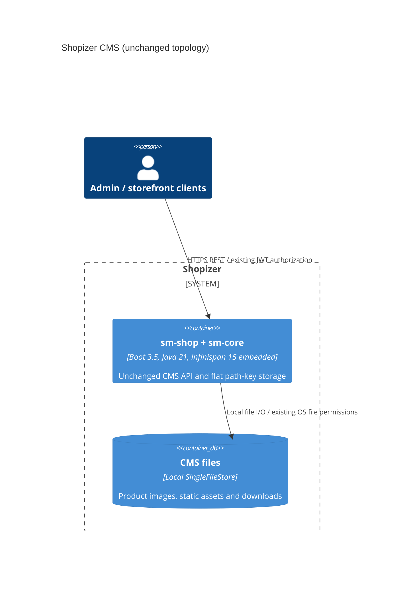

# 0005. Upgrade embedded CMS persistence to Infinispan 15

- **Status:** Proposed
- **Date:** 2026-11-12
- **ARB ticket:** TO BE CREATED
- **Authors:** Devin (AB-546)
- **Owning team:** TBD — owner to confirm before ARB
- **Related ADRs:** 0003 (Boot 3.5 / Java 21 / Jakarta cut-over), epic AB-531

## Context

Infinispan 9.4 is end-of-life and predates the Jakarta EE 10 baseline. AB-540
already removed TreeCache in favor of flat String path keys and byte-array
values. AB-546 owns the version/configuration upgrade only: CMS semantics and
REST/JWT contracts must remain unchanged.

ARB trigger: **T7 — major framework/dependency upgrade (Infinispan 9.4 → 15)**.
No new service, backend, vendor, infrastructure, integration or auth boundary.
The mechanical detector was blocked by the environment's plugin-path guardrail;
this verdict is a manual review against the ARB trigger table and the full diff.

## Decision

We will use embedded `infinispan-core` 15.0.22.Final on JDK 21 with its default
ProtoStream persistence marshaller. Retain all three non-segmented SingleFileStore
caches, their paths/names and write-behind settings. Remove the temporary Caffeine
2 override. Fail safely on pre-11 `FCS1` files and migrate existing flat stores
offline into a separate target with the upstream store migrator. Convert the
bundled seeds using that same procedure without dropping content.

## Alternatives considered

| Alternative | Pros | Cons | Why rejected |
| --- | --- | --- | --- |
| Do nothing: stay on 9.4 | No format conversion | EOL, javax-era dependency | Does not meet epic target |
| Move to SoftIndexFileStore or object storage | Avoids deprecated SingleFileStore | Changes storage/backend and operational semantics | Outside AB-546 scope |
| Automatically migrate stores during app startup | No manual cut-over step | Startup writes could damage rollback source; tree layout cannot be converted generically | Explicit offline copies are safer |

## Architecture

## Non-functional requirements

| NFR | Target | How met |
| --- | --- | --- |
| Availability SLO | TBD — owner to confirm before ARB | Same single-process topology; planned offline migration required |
| p95 latency | TBD — owner to confirm before ARB | Not benchmarked; storage/write-behind configuration unchanged |
| RPO / RTO | TBD — owner to confirm before ARB | Graceful shutdown flushes write-behind; crash before flush can still lose queued writes, as before; rollback requires backup |
| Peak load | TBD — owner to confirm before ARB | No new workload; restart tests include 128 KiB assets |
| Scaling model | Unchanged | Embedded, non-shared, local stores; no clustering introduced |
| Data retention | Unchanged | No expiration or purge-on-startup enabled in app |

## Security & compliance

- **Data classification:** Unchanged CMS assets/downloads; no new data categories.
- **Encryption at rest:** Unchanged filesystem/volume controls; no new encryption claims.
- **Encryption in transit:** Existing HTTPS boundary; no remote Infinispan transport.
- **AuthN / AuthZ:** Unchanged REST/JWT endpoints, roles and merchant isolation.
- **Secrets:** No new credentials or secret files; migration uses local copies.
- **Audit logging:** Existing application logging; startup errors retain their cause.
- **Data residency / regions:** Unchanged local deployment volume; no network export.
- **Policy sections satisfied:** N/A — no infrastructure changes or policy resources.
- **Threats considered:** Do not deserialize untrusted legacy stores during migration;
  do not add broad Java serialization allow-lists. Default ProtoStream supports
  String and byte-array CMS data without application class deserialization.

## Cost

| Item | Assumption | Monthly estimate |
| --- | --- | --- |
| Runtime | Same process and persistent volume; not a capacity benchmark | $0 expected incremental recurring cost |
| Migration disk | Temporary source/backup/target copies of existing CMS data | One-time capacity TBD — owner to confirm |
| **Total** | No new managed service/vendor | $0 expected incremental recurring cost |

## Operations

- **On-call rotation:** TBD — owner to confirm before ARB.
- **Runbook:** `docs/upgrade/infinispan-15.md` (scoped migration/verification/rollback).
- **Dashboards / alarms:** Unchanged; inspect startup/store failure logs.
- **Rollback plan:** Stop app; restore immutable 9.4 backup and previous application.
  Never downgrade in place over 15.x data; reconcile post-cut-over uploads.
- **Migration / cut-over plan:** Quiesce writers, migrate copies offline, compare
  counts/hashes and CMS API reads after restart, then install validated output.
  ARB approval gates only the final epic PR to `3.2.7`, per epic instructions.

## Policy exceptions requested

| Rule | Resource | Justification | Compensating control | Expiry |
| --- | --- | --- | --- | --- |
| none | | | | |

## Consequences

- Positive: Jakarta-aligned Infinispan 15; unchanged AB-540 round trips; separate-JVM
  persistence tests; seeded content retained with matching SHA-256.
- Negative / risks: Offline file-format migration is required; SingleFileStore is
  deprecated upstream. Write-behind retains its existing crash-loss window.
- Follow-ups: ARB review/ownership confirmation; AB-548 parity sign-off and AB-549
  epic-wide operations docs. Any backend replacement is a separate decision.

## Open questions

- Owning team/on-call rotation and availability, latency, peak-load, RPO/RTO targets.
- Size of deployment-specific CMS stores and disk capacity for backup/target copies.
- Whether any installation still has pre-AB-540 tree-layout data.
