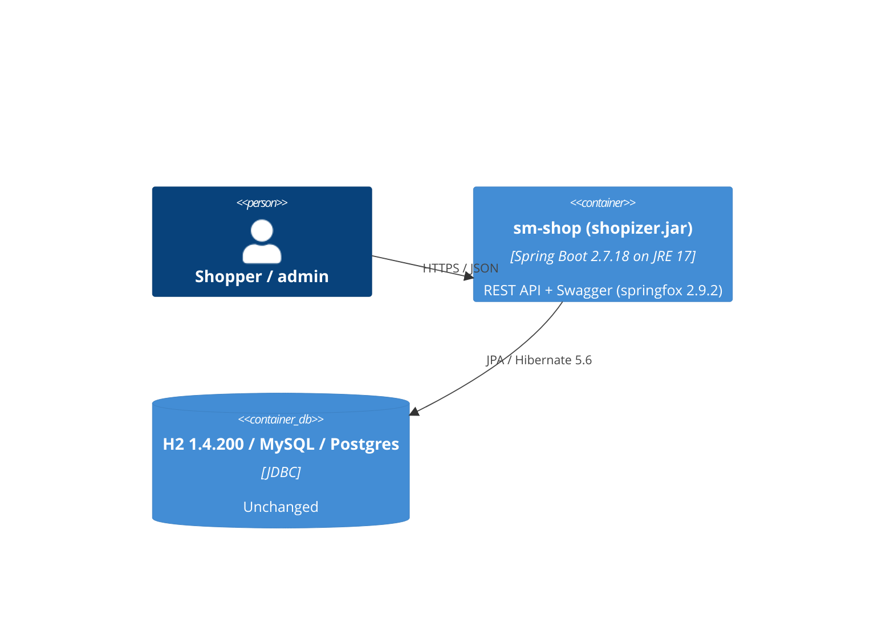

# ADR 0534: Java 17 bytecode baseline and Spring Boot 2.7.18 (AB-534)

- **Status:** Proposed
- **Date:** 2026-10-21
- **ARB ticket:** TO BE CREATED (merge waits on ARB approval)
- **Ticket:** AB-534 (parent epic AB-531, Shopizer to Spring Boot 3.5 / Java 21)

## ARB triage (done by hand from `arb-review` `rules/arb-triggers.md`)

| Trigger | Hit? | Evidence |
| --- | --- | --- |
| T7 framework/runtime upgrade | **Yes (major runtime)** | `maven.compiler.release` 11 to 17: every artifact (`sm-core*`, `sm-shop`, `shopizer.jar`) is now class-file version 61 and needs a Java 17+ runtime. The `sm-shop` container base image moves from `adoptopenjdk/openjdk11-openj9:alpine` to `eclipse-temurin:17-jre-alpine`. |
| T7 framework upgrade | Yes (minor) | Spring Boot 2.5.12 to 2.7.18 (Spring 5.3.31, Security 5.7, Hibernate 5.6). |
| T1-T6, T8, T9 | No | No new service, data store, vendor, contract, infra, auth or network change. The H2 version is pinned to the current 1.4.200, so the data store and its on-disk format are unchanged. |

Result: **ARB_REQUIRED** because of the Java runtime baseline change. The Boot minor bump alone would be ARB_LIGHT.

## Context

Shopizer builds with Java 11 `source`/`target` on Spring Boot 2.5.12, which is out of OSS support. Epic AB-531 moves to Boot 3.5 / Java 21. Boot 3 needs Java 17 and Spring Security 5.7's `SecurityFilterChain` model (AB-535). CI already runs on JDK 17 and 21.

## Decision

1. Use `spring-boot-starter-parent` 2.7.18, the last 2.x release.
2. Compile with `maven.compiler.release=17` instead of `source`/`target` 11, so the JDK API surface is checked as well as the bytecode level.
3. Keep runtime behaviour unchanged across the bump:
   - Set `spring.mvc.pathmatch.matching-strategy=ant_path_matcher`, and add a `BeanPostProcessor` in `DocumentationConfiguration` that hides `PathPatternParser`-based (actuator) handler mappings from springfox 2.9.2. springfox is removed in AB-536.
   - Set `spring.main.allow-circular-references=true` for the one existing cycle, `productService -> categoryService -> productService`, which is reached from `indexProductEventListener`. This is temporary until that cycle is cleaned up.
   - Pin `h2.version` to 1.4.200. The H2 2.x migration is AB-544.
4. Run the `sm-shop` image on Java 17: `eclipse-temurin:17-jre-alpine`.

## Alternatives considered

- **Go straight to Boot 3.x.** Rejected because it is too large for one step. The epic deliberately lands Wave 1 on Boot 2.7/javax first.
- **Keep Java 11 bytecode on Boot 2.7.** Rejected because Boot 3 needs 17, and CI no longer tests on 11.
- **Let Boot 2.7 manage H2 2.1.x.** Rejected because H2 2.1.x cannot open the bundled PageStore `SALESMANAGER.h2.db` or `mv_store=false` URLs.

## Non-functional requirements

- **Availability, load, RPO/RTO:** unchanged (same single deployable, same database).
- **Data classification:** unchanged. No schema or data change.
- **Compatibility:** deployments must run on JRE 17 or later. A Java 11 runtime fails with `UnsupportedClassVersionError`.

## Security and compliance

- Picks up Spring Framework, Security and Tomcat fixes up to the Boot 2.7.18 BOM.
- No change to authentication or authorization, data flows, secrets handling or audit logging. `WebSecurityConfigurerAdapter` is kept and only deprecated; it is rewritten in AB-535.

## Cost and ownership

- No new recurring cost.
- Owner: the Shopizer platform team that owns AB-531. Rollback is to revert this change; there are no data migrations.

## Context diagram

