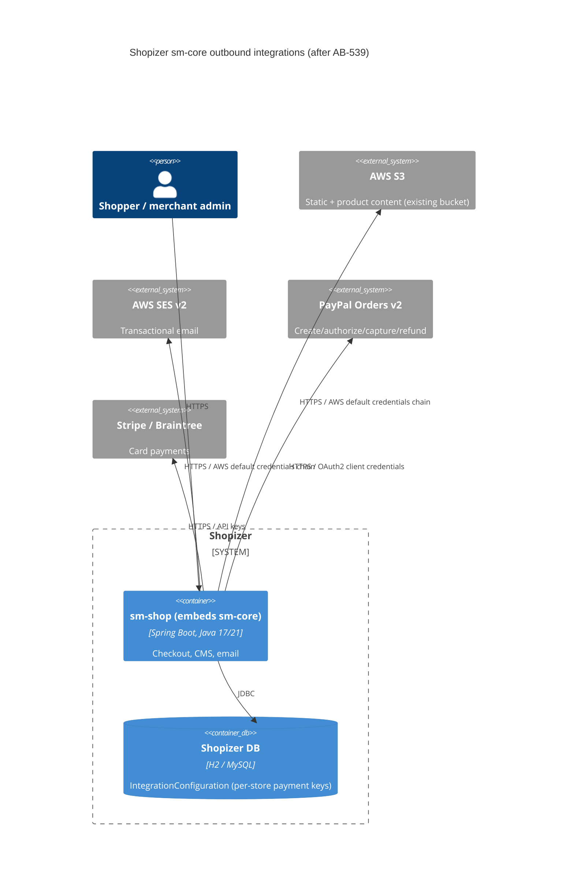

# AB-539. Migrate integration SDKs: AWS SDK v2, PayPal Orders v2, Stripe and Braintree current majors

- **Status:** Proposed
- **Date:** 2026-10-21
- **ARB ticket:** ARB-TBD (TO BE CREATED — no ARB Jira project is visible; merge to `3.2.7` waits on it)
- **Authors:** Devin (for Abhay Aggarwal)
- **Owning team:** Shopizer platform / commerce backend
- **Related ADRs:** none (epic AB-531, Spring Boot 3.5 / Java 21 upgrade)

## Context

`sm-core` integrates with four existing vendors through SDKs that are end-of-support or deprecated:

| Integration | Before | Problem |
| --- | --- | --- |
| S3 content (static + product files) | `aws-java-sdk-s3` 1.11.640 (AWS SDK for Java v1) | v1 reached end of support; no jakarta/Boot 3 future |
| SES email | `aws-java-sdk-ses` 1.11.640 | same |
| PayPal Express Checkout | `com.paypal.sdk:merchantsdk` 2.6.109 (NVP/SOAP, `urn.ebay.*`) | NVP/SOAP API and SDK deprecated by PayPal; signature credentials |
| Stripe / Braintree | `stripe-java` 19.5.0, `braintree-java` 2.73.0 | many majors behind; security/TLS fixes only in current majors |

These block AB-544 (Boot 3.5 + jakarta cut-over).

ARB triggers (hand triage against `arb-triggers.md`; the scripted detector is blocked by the guardrails plugin):

- **T3 (hit):** new network-calling libraries (`software.amazon.awssdk:s3`/`sesv2`, `com.paypal.sdk:paypal-server-sdk`) — same, already-used vendors.
- **T6 (hit):** PayPal outbound authentication changes from NVP API username/password/signature to OAuth2 client credentials (`clientId`/`clientSecret`); new secret material per merchant store.
- **T7 (minor):** major version bumps of existing SDKs (Stripe 19→34, Braintree 2→3). No framework/runtime change.
- T1, T2, T4, T5, T8, T9: not hit. No new service, data store, bucket, region, queue or public endpoint. S3 bucket/region keys and object key paths are unchanged.

Result: **ARB_REQUIRED** (T3 + T6 together exceed ARB_LIGHT, which covers T3 alone).

## Decision

We will replace AWS SDK v1 with AWS SDK v2 (`S3Client`, `SesV2Client`, BOM-managed, `DefaultCredentialsProvider`), replace the PayPal merchant SDK with the PayPal Server SDK (Orders v2: create / authorize / capture / refund) behind the unchanged `PaymentModule` contract and `paypal-express-checkout` module code, and bump `stripe-java` and `braintree-java` to their current majors with minimal API adaptation. Each client gets a test seam so mocked-SDK unit tests cover the modules.

## Alternatives considered

| Alternative | Pros | Cons | Why rejected |
| --- | --- | --- | --- |
| Do nothing | No migration risk | v1/NVP stay EOL; blocks Boot 3 / jakarta (AB-544) | Blocks the epic |
| Call PayPal Orders v2 REST directly (JDK `HttpClient`) | No new SDK dependency | Hand-rolled OAuth token caching, models and error mapping | More code to own than the vendor SDK |
| PayPal legacy REST SDK (`rest-api-sdk`, v1 Payments) | Smaller change | Also deprecated | Doesn't fix the problem |
| Keep AWS v1 with a bridge | No code change | Still EOL | Same |

## Architecture

## Non-functional requirements

| NFR | Target | How met |
| --- | --- | --- |
| Availability SLO | Unchanged | Same vendors, same call points |
| p95 latency | Unchanged | Synchronous calls as before; SDK clients reused instead of rebuilt per call where possible |
| RPO / RTO | N/A | No new data store |
| Peak load | Unchanged | — |
| Scaling model | Unchanged | Stateless SDK clients |
| Data retention | Unchanged | Same S3 keys and paths |

## Security & compliance

- **Data classification:** unchanged (payment tokens/ids, no card data stored; content files).
- **Encryption in transit:** TLS 1.2+ enforced by all new SDKs.
- **AuthN / AuthZ:** AWS via `DefaultCredentialsProvider` (env, system props, profile, container/instance role) — v1 `standard()` builders already used the default chain. PayPal moves to OAuth2 client credentials (short-lived tokens) instead of long-lived signature credentials.
- **Secrets:** PayPal `clientId`/`clientSecret` stored in the same per-store `IntegrationConfiguration` keys as the old credentials; no secrets in code or config files.
- **Audit logging:** unchanged.
- **Data residency / regions:** unchanged; region still from existing configuration.
- **Threats considered:** dependency supply chain (official vendor artifacts from Maven Central only); credential migration window (old PayPal keys stop working — see migration doc).

## Cost

| Item | Assumption | Monthly estimate |
| --- | --- | --- |
| SDK change | Same API call volumes | $0 incremental |
| **Total** | | **$0** |

## Operations

- **On-call rotation:** existing Shopizer backend owners.
- **Runbook:** `docs/migration/AB-539-integration-sdks.md` (config migration for AB-549).
- **Dashboards / alarms:** unchanged.
- **Rollback plan:** revert the PR; PayPal stores must restore their NVP credentials in the module configuration.
- **Migration / cut-over plan:** merchants create a PayPal REST app and enter `clientId`/`clientSecret` before deploy (AB-549).

## Policy exceptions requested

| Rule | Resource | Justification | Compensating control | Expiry |
| --- | --- | --- | --- | --- |
| none | | | | |

## Consequences

- Positive: removes EOL SDKs; unblocks AB-544; mocked-client tests for every integration module.
- Negative / risks: PayPal configuration is a breaking change for stores using `paypal-express-checkout`; after capture, `TRANSACTIONID` now holds the PayPal capture id (needed for v2 refunds).
- Follow-ups: AB-549 data/config migration and admin UI labels for the new PayPal keys.

## Open questions

- ARB ticket number (to be created).
